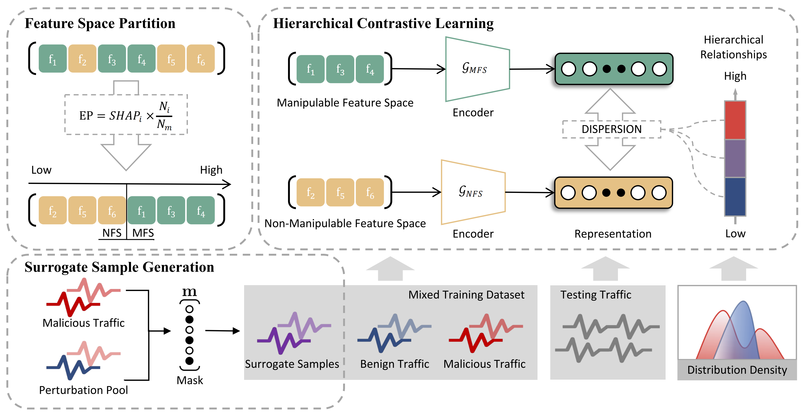

# HAD

Code for paper
HAD: Hierarchical Adversarial Defense for Network Intrusion Detection.

<div align="center">
<br>
Overview of HAD.
</div>

HAD partitions traffic features into a manipulable feature set (MFS) and a non-manipulable feature set (NFS) according to their evasion potential, generates surrogate adversarial samples by perturbing the MFS, and trains dual encoders with a hierarchical contrastive loss so that the dispersion between the two views satisfies benign < surrogate < malicious. A sample is flagged when its dispersion exceeds a threshold calibrated on benign traffic. HAD works as a standalone detector or as a supplement to an existing IDS.

## Requirements

```
pip install -r requirements.txt
```

## Usage

```
python main.py --dataset nsl --sigma 0.5
python main.py --dataset cic --sigma 0.9
```

The target IDS is a DNN; RF and GNB are trained as additional IDS models to evaluate transferability and supplementary detection. Adversarial test samples are generated by default (`src/attack.py`). Samples from any other attack can be used instead by saving the attacked test set as a `.npy` file:

```
python main.py --dataset nsl --adv_path x_adv.npy
```
